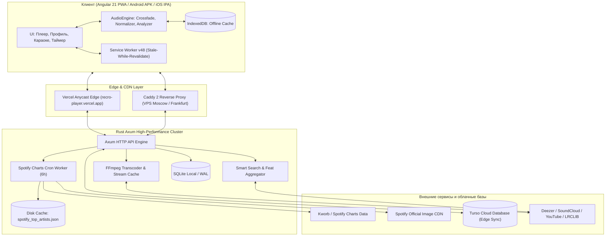

<div align="center">

# 🎵 Recro

### Minimalist Modern Web Audio Player, Smart Wave & Daily Spotify Charts

[-recro--player.vercel.app-007AFF?style=for-the-badge&logo=googlechrome&logoColor=white)](https://recro-player.vercel.app/#/)
[](https://recro-player.vercel.app/recro.apk)
[-white?style=for-the-badge&logo=apple&logoColor=black)](https://recro-player.vercel.app/recro.ipa)

[](https://angular.dev)
[](https://www.rust-lang.org)
[](https://turso.tech)
[](https://ffmpeg.org)
[](https://web.dev/progressive-web-apps/)
[](LICENSE)

**Recro** — ультрабыстрый, бескомпромиссный музыкальный веб-плеер нового поколения без рекламы и платных подписок. Объединяет стриминг студийного качества из глобальных каталогов (Deezer, SoundCloud, YouTube, Радио), продвинутый алгоритм персональных рекомендаций **«Моя Волна 2.0»** с поиском фитов и подбором по акустическому стилю, живое караоке с эталонной 1:1 синхронизацией текстов, умный таймер под задачи и **ежедневно обновляемый мировой чарт Spotify Top-50**.

</div>

---

> ### ⚡ **ОНЛАЙН ДОСТУП И СКАЧИВАНИЕ (РАБОТАЕТ ПРЯМО СЕЙЧАС):**
>
> 🌐 **Основной веб-плеер (Vercel CDN, работает без VPN в РФ и по всему миру):**  
> 👉 **[https://recro-player.vercel.app/#/](https://recro-player.vercel.app/#/)** 👈  
>
> 📱 **Скачать приложение на Android (APK):**  
> 👉 **[https://recro-player.vercel.app/recro.apk](https://recro-player.vercel.app/recro.apk)** *(зеркало: [http://80.87.202.157/recro.apk](http://80.87.202.157/recro.apk))* 👈  
>
> 🍏 **Скачать приложение на iPhone / iPad (IPA):**  
> 👉 **[https://recro-player.vercel.app/recro.ipa](https://recro-player.vercel.app/recro.ipa)** *(зеркало: [http://80.87.202.157/recro.ipa](http://80.87.202.157/recro.ipa))* 👈  
>
> 🌐 **Прямые ноды бэкенда и веб-плеера (VPS):**  
> • 🇷🇺 **Москва VPS (РФ без VPN):** [http://80.87.202.157/#/](http://80.87.202.157/#/)  
> • 🇩🇪 **Франкфурт VPS (Европа / с VPN):** [http://177.3.217.64/#/](http://177.3.217.64/#/)  
>
> *(Плеер полностью бесплатен, без рекламы, оптимизирован под все модели iPhone со всеми вырезами и Dynamic Island, а также Android, планшеты и ПК!)*

---

## 📸 Галерея интерфейса

### 🌟 Профиль пользователя и Ежедневный Топ-50 Spotify
<p align="center">
  
</p>

### 🎤 Синхронизированные тексты песен & ⏱️ Музыкальный таймер под задачи
<p align="center">
  
  
</p>

<details>
<summary><b>📱 Посмотреть десктопный и мобильный плеер</b></summary>
<br>

| Десктопный плеер | Мобильная адаптация |
| :---: | :---: |
|  |  |

</details>

---

## ✨ Ключевые возможности

### 🌊 1. Алгоритм «Моя Волна 2.0» (Smart Wave & Feat Discovery)
* **Поиск совместных треков (фитов):** Детектор коллабораций распознает связки артистов во всех форматах (`feat`, `ft`, `фит`, `при уч.`, `х`, `&`). Слушая любимого исполнителя, волна находит его совместные работы с другими артистами и расширяет подборку музыкой из их творческого круга.
* **Подбор по стилю, а не по ярлыку жанра:** Музыка сопоставляется по 8-мерному акустическому вектору (`energy`, `tempo`, `chill`, `acoustic`, `hiphop`, `electronic`, `rock`, `pop`), сравнивая звучание напрямую с текущим треком (`directSeedSim`), исключая ошибки неверных тегов стримингов.
* **Мгновенный старт 0ms:** Волна начинает играть в первую же миллисекунду после клика благодаря предварительно прогретому пулу треков.
* **Анти-повторы и защита от спама артистов:** Строгий кулдаун исключает повтор одного и того же артиста в очереди и ограничивает присутствие любого исполнителя в пуле волны максимум двумя треками.
* **100% языковая изоляция:** Строгое разделение отечественного и зарубежного потоков с возможностью переключения режима в один тап.
* **Режимы настроения:** Сбалансированный, Энергичный, Чилл, Только любимое.

### 🎤 2. Синхронизированные тексты песен (Karaoke & Live Lyrics)
* **Чистая 1:1 студийная синхронизация:** Устранено искусственное смещение таймингов — текст синхронизируется точно в такт вокалу исполнителя.
* **Многоуровневый агрегатор:** Поиск по базам LRCLIB, NetEase Cloud Music и Kugou с авто-фоллбэком.
* **Тонкая калибровка задержки:** Кнопки сдвига тайминга (`-5s`, `-1s`, `-0.2s`, `В такт`, `+0.2s`, `+1s`, `+5s`).
* **BPM-детектор:** Определение и вывод точного темпа композиции (ударов в минуту).

### 📊 3. Ежедневный Топ-50 Spotify (Daily Global Top Artists)
* **Мировые данные Spotify:** Интеграция с трекером *Kworb Spotify Charts* с суточным обновлением позиций.
* **Слушатели и динамика:** Количество ежемесячных слушателей (`129.8M слуш.`) и суточный прирост/падение (`▲ +41.5K` / `▼ -14.8K`).
* **Официальные HD-обложки:** Студийные фото 640×640 напрямую из CDN Spotify.
* **Мгновенная отдача:** Кэширование на стороне Rust-бэкенда — чарт отдается клиенту за **0.4 миллисекунды**.

### ⏱️ 4. Умный музыкальный таймер (Smart Task Timer)
* **Точный хронометраж:** Вы задаете время (15, 25, 30, 45, 60, 90, 120 минут), а алгоритм собирает сет треков с точностью до секунд.
* **Пресеты:**
  * 🧠 **Фокус и учеба** — Lo-Fi, неоклассика, инструментал.
  * ⚡ **Спорт и энергия** — фонк, рок, EDM, динамичный бит.
  * 🌙 **Сон и релакс** — эмбиент, акустика, звуки природы.
  * ❤️ **Только любимое** — персональный сет из «Избранного».
  * 🎲 **Вся моя музыка** — случайный сет из библиотеки.
* **Fade-Out:** Плавное затухание звука в конце таймера без резкого обрыва.

### 🎧 5. Аудиофильский движок и дизайн
* **Crossfade:** Бесшовное сведение треков без пауз и щелчков.
* **Нормализация громкости (EBU R128):** Автоматическое выравнивание уровней громкости.
* **Спектральный анализатор (Visualizer):** Живая визуализация частот в реальном времени.
* **Ambient Glow:** Динамическая подсветка интерфейса под палитру обложки трека.

### 🔍 6. Мультиплатформенный поиск и оффлайн
* **Глобальный поиск:** Поиск по каталогам Deezer, SoundCloud, YouTube и онлайн-радиостанциям.
* **Локальные файлы:** Воспроизведение MP3, FLAC, WAV, M4A, OGG через Drag & Drop.
* **Оффлайн-режим:** Кэширование треков в IndexedDB браузера в один клик.
* **PWA Service Worker (v48):** Моментальная загрузка из кэша (Stale-While-Revalidate), поддержка фонового воспроизведения и управления с экрана блокировки.

---

## 🏛️ Архитектура системы



---

## 💻 Технологический стек

| Область | Технологии |
| :--- | :--- |
| **Frontend** | Angular 21, TypeScript 5.9, SCSS, Angular Signals, RxJS, PWA Service Workers v48 |
| **Backend** | Rust 1.80+ (2021 Edition), Axum 0.8, Tokio Async Runtime, SQLx, Reqwest, Bcrypt, JWT |
| **Базы данных** | SQLite (WAL mode) + Turso Cloud (Edge Replication & Cloud Backup) |
| **Медиа-движок** | FFmpeg, yt-dlp, Web Audio API, Canvas 2D (Visualizer) |
| **Инфраструктура** | Docker Multi-stage, Caddy 2, Vercel Edge CDN, Nix Flakes |

---

## 🚀 Быстрый запуск

### Вариант 1. Через Docker Compose (Рекомендуется)

```bash
# 1. Клонируйте репозиторий
git clone https://github.com/Ren4ik7284/Recro.git
cd Recro

# 2. Запустите контейнеры
docker compose up --build -d
```

* **Веб-интерфейс:** `http://localhost:10000` (или порт из `.env`)
* **Бэкенд API:** `http://localhost:8085`

---

### Вариант 2. Локальная разработка

#### Требования:
* **Node.js** $\ge 20$ и **npm**
* **Rust** $\ge 1.80$ и **Cargo**
* Установленные в системе **FFmpeg** и **yt-dlp**

#### 1. Бэкенд (Rust)
```bash
cd backend

# Настройка переменных окружения (опционально)
cp ../.env.example .env

# Запуск в режиме разработки
cargo run
```
*Сервер запустится на `http://localhost:8085`.*

#### 2. Фронтенд (Angular)
```bash
cd frontend

# Установка зависимостей
npm install

# Запуск dev-сервера с hot-reload
npm start
```
*Приложение откроется на `http://localhost:4200`.*

---

## 🔧 Переменные окружения (`.env`)

| Переменная | Описание | Значение по умолчанию | Обязательно |
| :--- | :--- | :--- | :---: |
| `PORT` | Порт прокси/сервера | `10000` | Нет |
| `BACKEND_PORT` | Внутренний порт Rust-бэкенда | `8085` | Нет |
| `JWT_SECRET` | Секретный ключ для подписи токенов | Случайная строка | **Да** |
| `DATABASE_URL` | Путь к базе SQLite | `sqlite://signal.db?mode=rwc` | Нет |
| `TURSO_DATABASE_URL` | URL базы данных Turso Cloud | — | Опционально |
| `TURSO_AUTH_TOKEN` | Токен доступа к Turso Cloud | — | Опционально |
| `GOOGLE_CLIENT_ID` | OAuth Client ID Google | — | Опционально |
| `ALLOWED_ORIGINS` | Разрешенные CORS домены через запятую | `*` | Нет |

---

## 📡 Основные API Эндпоинты

| Метод | Эндпоинт | Описание |
| :--- | :--- | :--- |
| `GET` | `/api/top-artists` | Ежедневный мировой Топ-50 артистов Spotify (`?force=true` для принудительного обновления) |
| `GET` | `/api/search` | Универсальный поиск музыки (Deezer / SoundCloud / YouTube) |
| `GET` | `/api/stream` | Потоковое аудио с real-time транскодированием через FFmpeg |
| `GET` | `/api/lyrics` | Синхронизированные караоке-тексты песен |
| `GET` | `/api/recommendations` | Треки алгоритма «Моя Волна» по вкусовому профилю |
| `GET` | `/api/similar-tracks` | Поиск похожих треков и радио артистов |
| `GET` | `/api/stats/wrapped` | Персональная статистика и итоги прослушиваний (Wrapped) |
| `POST`| `/api/auth/register` | Регистрация нового пользователя |
| `POST`| `/api/auth/login` | Вход по логину и паролю |
| `POST`| `/api/auth/google` | Вход через Google OAuth |
| `GET` | `/api/health` | Проверка работоспособности сервиса |

---

## 📱 Установка на телефон (Android & iOS)

### Android (APK)
1. Скачайте свежий APK-файл: **[https://recro-player.vercel.app/recro.apk](https://recro-player.vercel.app/recro.apk)** *(или зеркало [http://80.87.202.157/recro.apk](http://80.87.202.157/recro.apk))*
2. Разрешите установку из неизвестных источников и установите `.apk`.

### iOS / iPadOS (IPA для владельцев сертификатов)
1. Скачайте свежий IPA-пакет: **[https://recro-player.vercel.app/recro.ipa](https://recro-player.vercel.app/recro.ipa)** *(или зеркало [http://80.87.202.157/recro.ipa](http://80.87.202.157/recro.ipa))*
2. Откройте приложение для подписи на iPhone: **ESign**, **Scarlet**, **Gbox**, **SideStore**, **AltStore** или **TrollStore**.
3. Импортируйте `recro.ipa`, подпишите сертификатом и нажмите **«Установить»**.

### iOS / iPadOS (Без сертификата — PWA в 1 клик)
1. Откройте **[https://recro-player.vercel.app](https://recro-player.vercel.app)** в браузере **Safari**.
2. Нажмите кнопку **«Поделиться»** (квадрат со стрелочкой вверх ⬆).
3. Пролистайте вниз и выберите **«На экран "Домой"» (Add to Home Screen)**.
4. Нажмите **«Добавить»** в правом верхнем углу.

---

## 🚀 Деплой обновлений на сервер

Чтобы быстро залить обновления фронтенда или бэкенда на все узлы кластера (Москва, Франкфурт, Vercel):

```bash
# 1. Быстрый деплой фронтенда на все VPS и Vercel (~15 сек)
bash scripts/deploy.sh frontend
# или из папки frontend:
npm run deploy

# 2. Полный деплой (фронтенд + сборка и перезапуск Rust-бэкенда)
bash scripts/deploy.sh all
# или из папки frontend:
npm run deploy:all
```

---

## 📄 Лицензия

Проект распространяется под лицензией **MIT**. Подробности в файле [LICENSE](LICENSE).

<div align="center">
  <b>Сделано с любовью к музыке и открытому коду 🎧</b>
</div>
