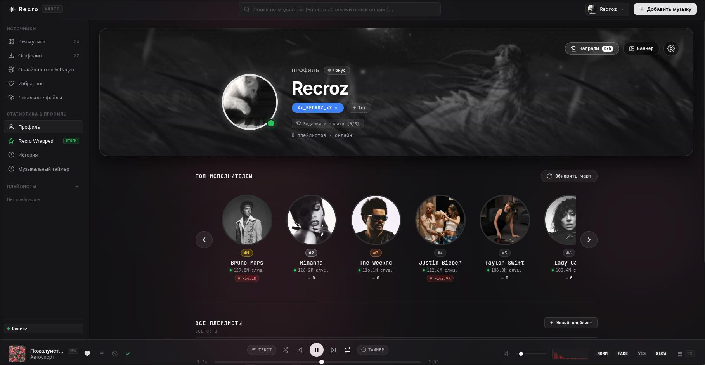
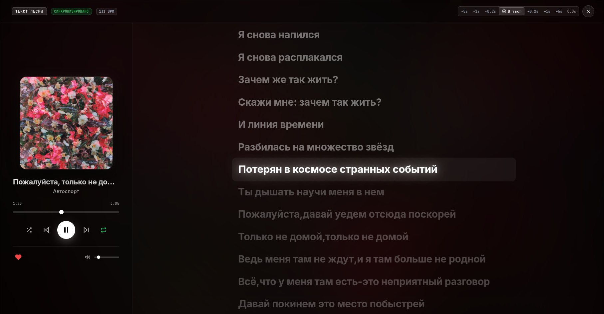
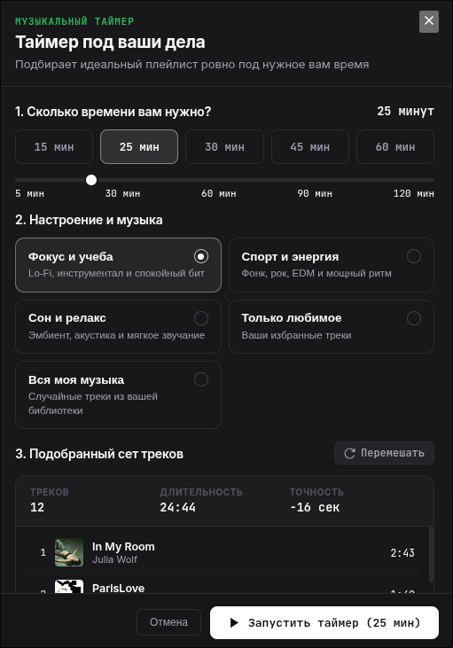
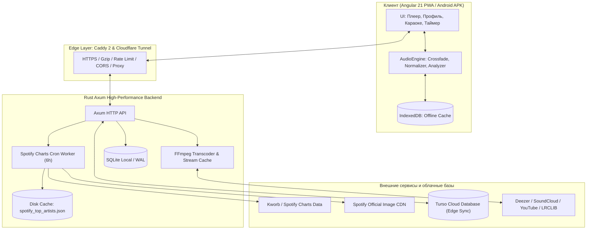

<div align="center">

# 🎵 Recro

### Minimalist Modern Web Audio Player, Smart Wave & Daily Spotify Charts

[-HTTPS_Let's_Encrypt-007AFF?style=for-the-badge&logo=googlechrome&logoColor=white)](https://recro.177.3.217.64.sslip.io/#/)
[](https://gilbert-focusing-hoped-static.trycloudflare.com/#/)
[](http://177.3.217.64/#/)
[](https://recro.177.3.217.64.sslip.io/recro.apk)
[-white?style=for-the-badge&logo=apple&logoColor=black)](https://recro.177.3.217.64.sslip.io/recro.ipa)

[](https://angular.dev)
[](https://www.rust-lang.org)
[](https://turso.tech)
[](https://ffmpeg.org)
[](https://web.dev/progressive-web-apps/)
[](LICENSE)

**Recro** — быстрый, бескомпромиссный музыкальный плеер нового поколения без рекламы и платных подписок. Объединяет стриминг студийного качества из множества источников (Deezer, SoundCloud, YouTube, Радио), алгоритм персональных рекомендаций **«Моя Волна»**, живое караоке с синхронизированными текстами, умный таймер под задачи и **ежедневно обновляемый мировой чарт Spotify Top-50**.

</div>

---

> ### ⚡ **ОНЛАЙН ДОСТУП И СКАЧИВАНИЕ (РАБОТАЕТ ПРЯМО СЕЙЧАС):**
>
> ⚡ **Основной веб-хост (РФ и весь мир БЕЗ VPN, HTTPS):** 👉 **[https://recro.177.3.217.64.sslip.io/#/](https://recro.177.3.217.64.sslip.io/#/)** 👈  
> ☁️ **Зеркало Cloudflare Tunnel (С VPN / альтернатива):** 👉 **[https://gilbert-focusing-hoped-static.trycloudflare.com/#/](https://gilbert-focusing-hoped-static.trycloudflare.com/#/)** 👈  
> 🌐 **Прямой IP хост (HTTP):** 👉 **[http://177.3.217.64/#/](http://177.3.217.64/#/)** 👈  
> ☁️ **Облачное зеркало (Render):** 👉 **[https://recro.onrender.com](https://recro.onrender.com)** 👈  
> 📱 **Скачать приложение на Android (APK):** 👉 **[https://recro.177.3.217.64.sslip.io/recro.apk](https://recro.177.3.217.64.sslip.io/recro.apk)** 👈  
> 🍏 **Скачать приложение на iPhone (IPA для сертификата):** 👉 **[https://recro.177.3.217.64.sslip.io/recro.ipa](https://recro.177.3.217.64.sslip.io/recro.ipa)** 👈  
>
> *(Плеер полностью бесплатен, без рекламы, оптимизирован под все модели iPhone со всеми вырезами и Dynamic Island, а также Android и ПК!)*

---

## 📸 Галерея интерфейса

### 🌟 Профиль пользователя и Ежедневный Топ-50 Spotify
<p align="center">
  
</p>

### 🎤 Синхронизированные тексты песен & ⏱️ Музыкальный таймер под задачи
<p align="center">
  
  
</p>

<details>
<summary><b>📱 Посмотреть десктопный и мобильный плеер</b></summary>
<br>

| Десктопный плеер | Мобильная адаптация |
| :---: | :---: |
|  |  |

</details>

---

## ✨ Ключевые возможности

### 📊 1. Ежедневный Топ-50 Spotify (Daily Global Top Artists)
* **Настоящие данные Spotify:** Интеграция с мировым трекером *Kworb Spotify Charts*, который обновляет позиции каждые 24 часа.
* **Слушатели и динамика:** Отображение реального количества ежемесячных слушателей на Spotify (например, `129.8M слуш.`) и суточного прироста/падения (`▲ +41.5K` / `▼ -14.8K`).
* **Официальные HD-обложки:** Автоматическое подтягивание оригинальных студийных фото 640×640 напрямую из CDN Spotify (`image-cdn-ak.spotifycdn.com`).
* **Фоновый воркер и моментальный отклик:** Встроенный в Rust-бэкенд планировщик тихо обновляет чарт раз в 6 часов и кэширует его на диск — плеер отдает топ за **0.4 миллисекунды**.
* **Быстрый запуск:** Клик по исполнителю мгновенно открывает поиск и дискографию его лучших треков.

### ⏱️ 2. Умный музыкальный таймер (Smart Task Timer)
* **Идеальный хронометраж:** Вы задаете время (15, 25, 30, 45, 60, 90, 120 минут), а алгоритм собирает сет треков с точностью до нескольких секунд.
* **Пресеты под контекст:**
  * 🧠 **Фокус и учеба** — расслабляющий Lo-Fi, неоклассика и фоновый бит.
  * ⚡ **Спорт и энергия** — бодрящий фонк, рок, EDM и мощный грув.
  * 🌙 **Сон и релакс** — эмбиент, мягкая акустика и звуки природы.
  * ❤️ **Только любимое** — персональная подборка из вашего «Избранного».
  * 🎲 **Вся моя музыка** — случайный сет из медиатеки.
* **Плавное затухание (Fade-Out):** В последние секунды громкость мягко снижается до нуля без резких обрывов звука.

### 🎤 3. Синхронизированные тексты песен (Karaoke & Live Lyrics)
* **Строка в строку:** Тексты песен подсвечиваются и плавно прокручиваются синхронно с голосом исполнителя.
* **BPM-детектор:** Определение и вывод точного темпа композиции (ударов в минуту).
* **Тонкая подстройка тайминга:** Кнопки сдвига задержки (`-5s`, `-1s`, `-0.2s`, `В такт`, `+0.2s`, `+1s`, `+5s`) для идеальной калибровки.
* **Многоуровневый поиск:** Агрегация баз LRCLIB, NetEase Cloud Music и Kugou.

### 🌊 4. Алгоритм «Моя Волна» (Smart Wave 2.0)
* **100% изоляция языковых потоков:** При прослушивании зарубежной музыки волна удерживает строго иностранные треки; при переходе на русскую — моментально перестраивается на отечественный контекст.
* **Фильтр медиатеки (Чистые открытия):** Треки, уже добавленные в вашу библиотеку, исключаются из режима открытий волны, расширяя музыкальный кругозор.
* **Защита от ложных скипов и обрывов:** При нестабильном интернет-соединении плеер автоматически подхватывает позицию трека и перезапускает воспроизведение без пропуска композиции.
* **Предиктивная буферизация:** Следующий трек очереди предварительно кэшируется, гарантируя моментальный переход без лагов и задержек.
* **Векторная модель косинусного сходства:** Непрерывное обучение вкусового вектора (энергия, акустичность, ритм, танцевальность) с отсечением нерелевантного контента ($\ge 0.38$).
* **Пул студийных открытий (`onlineDiscoveryPool`):** Постоянный буфер радио-рекомендаций артистов, гарантирующий качественные релизы без перехода в низкопробный мусор.
* **Режимы настроения:** Сбалансированный, Энергичный, Чилл, Только любимое.

### 🎧 5. Аудиофильский движок и дизайн
* **Crossfade (Плавный переход):** Бесшовное сведение треков между собой без тишины.
* **Нормализация громкости (EBU R128):** Автоматическое выравнивание уровней громкости разных треков.
* **Спектральный анализатор (Visualizer):** Живая визуализация частот в реальном времени.
* **Ambient Glow:** Фоновая подсветка интерфейса динамически адаптируется под доминирующие цвета обложки текущего трека.

### 👤 6. Профиль, кастомизация и статистика
* **Динамический брендинг исполнителей:** При наведении на артиста в чарте вычисляется стабильный HEX/HSL-цвет и неоновое свечение на основе DJB2-хэша имени.
* **Кастомизация аватара:** Настройка стильных анимированных и неоновых рамок.
* **Обложки и баннеры профиля:** Загрузка собственных артов или выбор из готовых пресетов.
* **Вайб и теги:** Установка цветных бейджей статуса и музыкального настроения.
* **Recro Wrapped:** Персональные итоги прослушиваний за год и месяц (любимые жанры, топовые треки, часы музыки) в чистом дизайне.

### 🔍 7. Мультиплатформенный поиск и оффлайн
* **Единая строка поиска:** Поиск по всей глобальной базе Deezer, SoundCloud, YouTube и каталогу онлайн-радиостанций.
* **Локальные файлы:** Поддержка воспроизведения собственных MP3, FLAC, WAV, M4A, OGG через перетаскивание (Drag & Drop).
* **Оффлайн-режим:** Кэширование треков в IndexedDB браузера в один клик для прослушивания в самолёте или без связи.
* **PWA & Android APK:** Возможность установки как полноценного приложения с управлением в шторке Android и на экране блокировки iOS.

---

## 🏛️ Архитектура системы



---

## 💻 Технологический стек

| Область | Технологии |
| :--- | :--- |
| **Frontend** | Angular 21, TypeScript 5.9, SCSS, Angular Signals, RxJS, PWA Service Workers |
| **Backend** | Rust 1.80+ (2021 Edition), Axum 0.8, Tokio Async Runtime, SQLx, Reqwest, Bcrypt, JWT |
| **Базы данных** | SQLite (WAL mode) + Turso Cloud (Edge Replication & Cloud Backup) |
| **Медиа-движок** | FFmpeg, yt-dlp, Web Audio API, Canvas 2D (Visualizer) |
| **Инфраструктура** | Docker Multi-stage, Caddy 2, Render, Nix Flakes |

---

## 🚀 Быстрый запуск

### Вариант 1. Через Docker Compose (Рекомендуется)

```bash
# 1. Клонируйте репозиторий
git clone https://github.com/Ren4ik7284/Recro.git
cd Recro

# 2. Запустите контейнеры
docker compose up --build -d
```

* **Веб-интерфейс:** `http://localhost:10000` (или порт, указанный в `.env`)
* **Бэкенд API:** `http://localhost:8085`

---

### Вариант 2. Локальная разработка

#### Требования:
* **Node.js** $\ge 20$ и **npm**
* **Rust** $\ge 1.80$ и **Cargo**
* Установленные в системе **FFmpeg** и **yt-dlp**

#### 1. Бэкенд (Rust)
```bash
cd backend

# Настройка переменных окружения (опционально)
cp ../.env.example .env

# Запуск в режиме разработки
cargo run
```
*Сервер запустится на `http://localhost:8085`.*

#### 2. Фронтенд (Angular)
```bash
cd frontend

# Установка зависимостей
npm install

# Запуск dev-сервера с hot-reload
npm start
```
*Приложение откроется на `http://localhost:4200`.*

---

## 🔧 Переменные окружения (`.env`)

| Переменная | Описание | Значение по умолчанию | Обязательно |
| :--- | :--- | :--- | :---: |
| `PORT` | Порт прокси/сервера | `10000` | Нет |
| `BACKEND_PORT` | Внутренний порт Rust-бэкенда | `8085` | Нет |
| `JWT_SECRET` | Секретный ключ для подписи токенов | Случайная строка | **Да** |
| `DATABASE_URL` | Путь к базе SQLite | `sqlite://signal.db?mode=rwc` | Нет |
| `TURSO_DATABASE_URL` | URL базы данных Turso Cloud | — | Опционально |
| `TURSO_AUTH_TOKEN` | Токен доступа к Turso Cloud | — | Опционально |
| `GOOGLE_CLIENT_ID` | OAuth Client ID Google | — | Опционально |
| `ALLOWED_ORIGINS` | Разрешенные CORS домены через запятую | `*` | Нет |

---

## 📡 Основные API Эндпоинты

| Метод | Эндпоинт | Описание |
| :--- | :--- | :--- |
| `GET` | `/api/top-artists` | Ежедневный мировой Топ-50 артистов Spotify (`?force=true` для принудительного обновления) |
| `GET` | `/api/search` | Универсальный поиск музыки (Deezer / SoundCloud / YouTube) |
| `GET` | `/api/stream` | Потоковое аудио с real-time транскодированием через FFmpeg |
| `GET` | `/api/lyrics` | Синхронизированные караоке-тексты песен |
| `GET` | `/api/recommendations` | Треки алгоритма «Моя Волна» по вкусовому вектору |
| `GET` | `/api/stats/wrapped` | Персональная статистика и итоги прослушиваний (Wrapped) |
| `POST`| `/api/auth/register` | Регистрация нового пользователя |
| `POST`| `/api/auth/login` | Вход по логину и паролю |
| `POST`| `/api/auth/google` | Вход через Google OAuth |
| `GET` | `/api/health` | Проверка работоспособности сервиса |

---

## 📱 Установка на телефон (Android & iOS)

### Android (APK)
1. Скачайте готовый APK-файл: **[http://177.3.217.64/recro.apk](http://177.3.217.64/recro.apk)** *(или зеркало: [https://recro.onrender.com/recro.apk](https://recro.onrender.com/recro.apk))*
2. Разрешите установку из неизвестных источников и запустите `.apk`.

### iOS / iPadOS (IPA для владельцев сертификатов)
1. Скачайте готовый IPA-пакет: **[https://recro.177.3.217.64.sslip.io/recro.ipa](https://recro.177.3.217.64.sslip.io/recro.ipa)** *(или [http://177.3.217.64/recro.ipa](http://177.3.217.64/recro.ipa))*
2. Откройте приложение для подписи на iPhone: **ESign**, **Scarlet**, **Gbox**, **SideStore**, **AltStore** или **TrollStore**.
3. Импортируйте `recro.ipa`, подпишите вашим личным или корпоративным сертификатом и нажмите **«Установить»**.
4. Приложение установится на рабочий стол со всеми нативными возможностями и фоновым звуком.

### iOS / iPadOS (Без сертификата — PWA в 1 клик)
1. Откройте **[https://recro.177.3.217.64.sslip.io](https://recro.177.3.217.64.sslip.io)** *(или зеркало [https://gilbert-focusing-hoped-static.trycloudflare.com](https://gilbert-focusing-hoped-static.trycloudflare.com))* в браузере **Safari**.
2. Нажмите кнопку **«Поделиться»** (квадрат со стрелочкой вверх ⬆).
3. Пролистайте вниз и выберите **«На экран "Домой"» (Add to Home Screen)**.
4. Нажмите **«Добавить»** в правом верхнем углу.

---

## 📄 Лицензия

Проект распространяется под лицензией **MIT**. Подробности в файле [LICENSE](LICENSE).

<div align="center">
  <b>Сделано с любовью к музыке и открытому коду 🎧</b>
</div>
